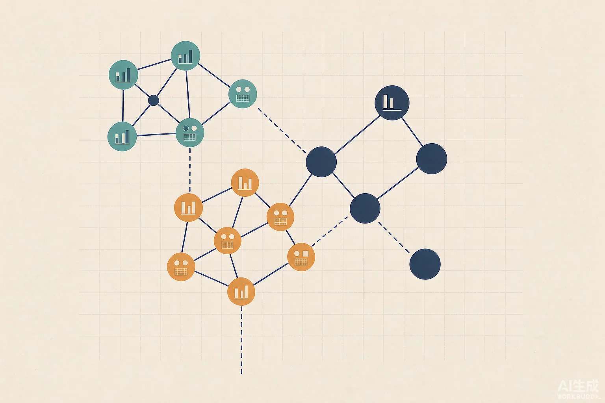
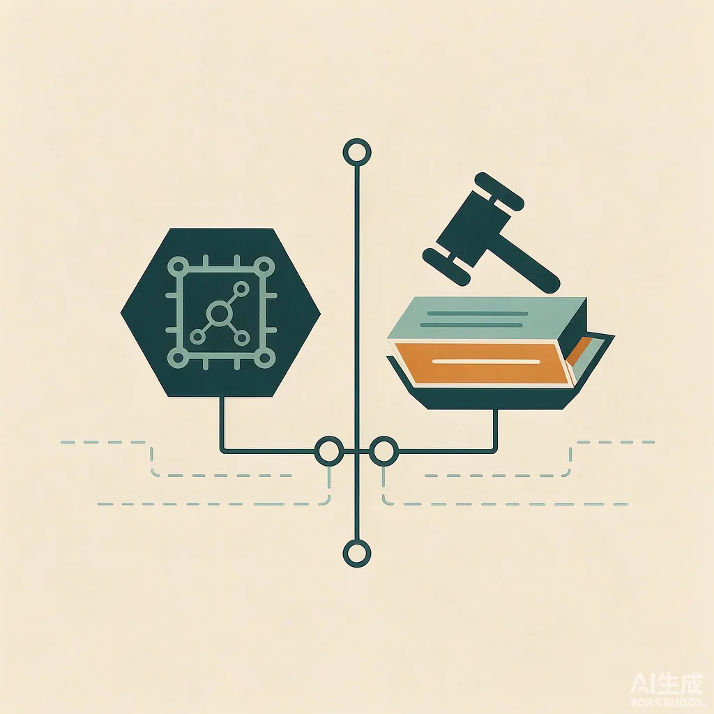

2026 年 11 月 13 日是个信息密度很高的周五。把当天公开报道摊开看，会发现变动并不只发生在模型榜单上：价格、公司人事、智能体的权限边界，以及法院，都在同一天给出了各自的答案。下面按主题梳理，尽量只写有多源印证的部分，并在结尾说明信息口径。

## 一、模型：价格战打到了「每百万 token 1.5 美元」

Google 发布 **Gemini 4 Hydrogen**，这是其六周内的第三款新模型。它主打编码与 Agent 工作流，走的是更快、更便宜的路线：多家日报给出的定价为输入约 1.5 美元 / 百万 token、输出约 7.5 美元 / 百万 token，支持百万级上下文，覆盖 Gemini 应用、API 与 AI Studio，并进入 Google Search 与免费档。Google 自报的编码测试里，它相比更高档的 Carbon 少用约 24% 配额、完成时间快约 19%——这是厂商自测口径，不宜当作跨模型结论。[AI Digest](https://pod.aiiris.org/) · [腾讯新闻 AIbase 日报](https://news.qq.com/rain/a/20261113A0AYHO00) · [CSDN 行业日报](https://thinkbar.blog.csdn.net/article/details/170758785)

同一天国内也有密集发布：百度世界 2026 上推出文心闪电深度思考模型与文心一镜微表情模型，阿里上线 Qwen4-Max 预览版，美团开源 LongCat 多模态模型。这部分主要来自媒体汇总日报，参数与许可细节请以各厂商公告为准。[每日 AI 新闻摘要](https://www.toutiao.com/a1881729893730316)

值得留意的不是「又发了一个模型」，而是**前沿能力被主动下放到免费档与默认搜索入口**。当调用成本继续下探，竞争重心会从「谁更聪明」转向「谁能在既定成本下被更多真实流程调用」。

## 二、算力：英伟达宣布领导层变动

多家媒体日报报道，英伟达创始人黄仁勋卸任 CEO，结束逾三十年的掌舵，由 CFO Colette Kress 出任临时 CEO。[腾讯新闻](https://news.qq.com/rain/a/20261113A0AYHO00) · [CSDN 行业日报](https://thinkbar.blog.csdn.net/article/details/170758785) · [AI News Brief](https://www.ai-news-brief.info/ai-news-brief-roundup-2026-11-13-overnight)

各报道对变动背景的说法并不一致，涉及调查、舆论压力等不同叙述，且当日还伴随国会方面对华芯片销售的问询报道。**此处只记录「人事变动」这一被多源确认的事实，不采信任何单一口径的原因解释**；后续安排与官方说明仍应以英伟达公告为准。市场层面，外界关心的是 GPU 供应节奏与 AI 基础设施路线图是否会因此调整。

## 三、智能体：从「会回答」走向「被授权去做事」

这一天的产品更新有一个共同点——都在处理权限，而不是话术。

- **Anthropic** 推出 Claude Meetings，让 Claude 以可见参会者身份接入 Google Meet，在会议进行中记录、答疑并生成产物；同时开放自托管 Claude Managed Agents 私测，把沙箱、凭据处理与会话历史放进企业自有基础设施，以适配零数据留存要求。[AI Digest](https://pod.aiiris.org/) · [CSDN 行业日报](https://thinkbar.blog.csdn.net/article/details/170758785)
- **OpenAI** 推出 ChatGPT Wallet，允许智能体在用户明确批准、沿用既有卡片保护的前提下完成购买，被视为代理走向真实交易的一步。[AI NewsCycle](https://ainewscycle.com/) · [CSDN 行业日报](https://thinkbar.blog.csdn.net/article/details/170758785)
- **Google** 扩展 Chrome 中的 Gemini 侧边栏，并发布新一代 Gemini Robotics 视觉-语言-动作模型与 AlphaGenome 2。[CSDN 行业日报](https://thinkbar.blog.csdn.net/article/details/170758785)

配套的安全侧也在同步跟进：据 [AI News Brief](https://www.ai-news-brief.info/ai-news-brief-roundup-2026-11-13-overnight) 汇总，IBM 收购身份安全公司 AuthMind 并计划整合进 HashiCorp Vault，用于监控智能体在凭据签发之后的使用；Google 公布的 Agent Anomaly Detection 外部基准中，对已执行的有害指令识别率为 87%，但在「被投毒的记忆」上表现较弱，高影响工具任务的误报最高达 16%。**能力越接近真实操作，可审计性与误报代价就越成为产品指标。**

## 四、治理：一纸要求「暂停前沿研发」的诉讼

美国四家非营利机构（报道提及 Public Citizen、Irreplaceable Education Fund 等）在旧金山高等法院起诉 OpenAI、Anthropic、谷歌、Meta 及 SpaceX 旗下 AI 部门，援引加州反不正当竞争法，请求法院颁布禁令，叫停前沿模型的进一步研发与部署。诉状引用了各公司高管关于 AI 风险的公开表态，以及已记录的 AI 系统参与网络攻击等案例。[中新经纬（转美联社）](https://www.163.com/dy/article/LBJL4CJU0519C6T9.html) · [环球网（转路透社）](https://www.163.com/dy/article/LBK135QK0514R9OJ.html)

与以往围绕版权、隐私的 AI 诉讼不同，这次的诉求直接指向**研发活动本身**，报道普遍认为尚无同类判例可援引；截至当日，被告方未公开回应。无论结果如何，它把一个问题摆到了台面上：当企业自己都在公开警示极端风险时，这些表述会在多大程度上成为外部追责的依据。

## 五、开源：中国模型进入海外生产系统

新华社报道，正在里斯本举行的 2026 网络峰会上，英国金融科技公司 Revolut 已将原先使用的 OpenAI 与 Anthropic 编程助手替换为智谱开源 GLM 系列，成为约 2000 名工程师的默认编程模型；企业方称上线后平均编程耗时缩短约 60%、AI 调用成本下降近 90%。法新社报道另提到，法国 Orange、雷诺与德国西门子等企业已公开表示使用 DeepSeek、通义千问等中国模型，作为美欧本土模型的补充。[央视网转新华社](https://big5.cctv.com/gate/big5/news.cctv.cn/2026/11/13/ARTI8jijUA0t4yQ9Pa5jznM8261113.shtml)

开源模型在此处的吸引力并不神秘：可下载、可二次修改、可部署在自有服务器，同时兼顾数据掌控与成本。对算力与人才储备有限的国家，它还意味着不必从零训练千亿参数也能拥有本地语言与法规适配的基础设施。

## 六、资本：钱流向「编排层」与推理成本

据 [AI News Brief](https://www.ai-news-brief.info/ai-news-brief-roundup-2026-11-13-overnight) 与 [CSDN 行业日报](https://damodev.csdn.net/6af6671d40858c2d881b11e9.html) 汇总，智能体框架 LangChain 完成 3 亿美元融资、估值约 30 亿美元，由 Alphabet 旗下 CapitalG 领投；AI 推理芯片初创 Fractile 完成 7.2 亿美元 C 轮，估值约 70 亿美元。另有单一来源报道称 OpenAI 第三季度营收首次突破 100 亿美元、同期经调整经营亏损约 109 亿美元（转引 CNBC，[链接](https://www.toutiao.com/a1881729893730316)），该项未获当日其他来源交叉印证，仅作记录。

把这几笔放在一起看，资本的关注点已从「再训一个更大的模型」，扩散到编排、治理、推理成本与单位经济性。

## 一点观察

这一天其实只有三条线：**能力在变便宜，能力开始代替人动手，能力因此被要求踩刹车。** 它们互为因果——价格越低、部署越广，智能体拿到的权限就越大；权限越大，审计、责任与司法介入就来得越快。

于是稀缺的东西变了。模型能不能做到，越来越不是问题；**谁授权、谁核验、出了问题谁负责**，反而成了产品、法务与用户共同要回答的部分。这大概也是这轮新闻里，最值得记下来的一句。

## 信息说明

- 本文整理于 2026 年 11 月 14 日，覆盖 11 月 13 日的公开报道，优先采用多源交叉印证的事件。
- 文中数字多为企业自报或媒体转述，未逐条向厂商公告核实；单一来源的条目已单独标注。英伟达人事变动的具体背景各方说法不一，本文不作归因。
- 两张配图均为 AI 生成的示意插画，不是新闻现场图片，也不对应任何具体公司或产品。
