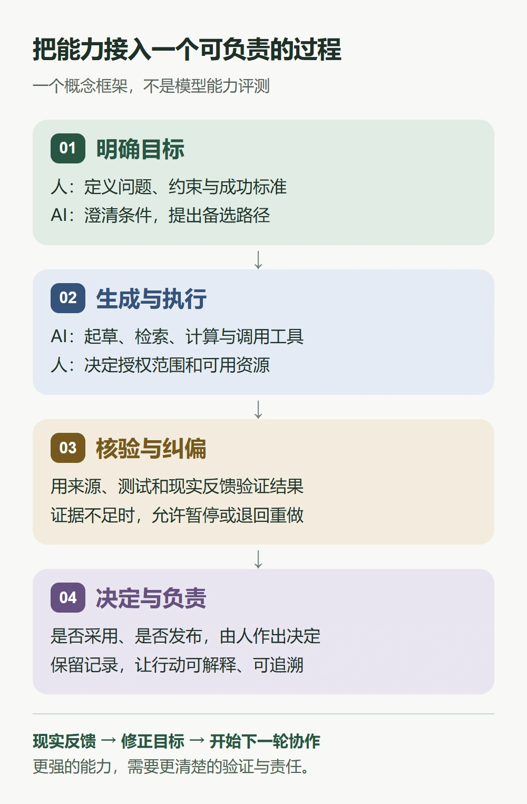

如果一定要用一句话表达我的理解，我会说：**AGI 时代最值得关注的变化，是人获得更大行动能力之后，如何使用这种能力。**

这听起来没有“机器超越人类”的叙事那么惊险，却离生活更近。当一个普通人可以借助 AI 学习陌生知识、制作工具、组织信息，甚至把一个想法推进到可运行的项目时，问题就会从“我做不做得到”，逐渐转向“这件事值得做吗”“怎样才算做对了”“出了问题由谁负责”。

我不把下面这些想法当作未来必然发生的剧本。它们是一种观察方向：如果通用智能能力继续发展，我们应该提前想清楚什么。

## 先说清楚：我这里所说的 AGI 是什么

AGI 通常被译为“通用人工智能”。在这篇文章里，我把它当作一个工作性概念：一种能够在广泛任务中学习、迁移知识并解决问题的人工智能能力，而不只是擅长某一个固定任务的程序。

这个概念并没有一条人人认可的到达线。研究者提出过按任务广度、表现水平等维度讨论 AGI 的框架，也把自主性作为需要单独考察的维度。[1] 这种区分很有帮助：**会做多少事、做得多好，以及被允许独立做多少事，是不同的问题。**

能写出流畅文章，不等于能够可靠地完成长期研究；会调用工具，不等于应该获得所有操作权限。至于系统是否拥有主观体验，更不能仅凭语言表现就得出结论。

因此，我谈论“AGI 时代”，不是宣布某个产品已经通过了终极考试，而是在讨论：当越来越通用的能力进入日常生活，我们该怎样与之相处。

## 真正让我在意的，是想法与行动之间的距离

一张夜间地球的合成影像，可以作为理解技术社会的比喻。那些灯光让人想到城市、能源与无数彼此连接的生活。真正有力量的技术，最终会进入这些具体的联系之中。

我也更愿意这样理解 AI 的价值：它能不能帮助一个人跨过原本难以跨越的门槛？

以个人博客为例。过去，一个有表达欲望、却不熟悉开发的人，可能会停在域名、页面、构建与发布这些环节。借助 AI，他可以更快地理解配置、整理文章、检查错误，把心里的一个小空间搭出来。但博客为什么存在、哪些内容值得公开、怎样对读者负责，仍需要作者自己决定。

如果类似的门槛在更多领域降低，一些原本只能停留在纸上的计划，就可能获得被尝试的机会。一位教师可以制作适合自己课堂的小工具，一个小团队可以验证服务原型，一个人也可以为自己的特殊需求写出软件。

我期待的进步，首先是这种“有机会试一试”的扩大。它并不保证每个想法都会成功，却可能让表达和创造不再那么依赖一整套专业资源。

## 当答案变多，稀缺的东西会换位置

如果生成一份看起来完整的答案越来越容易，那么“拿到答案”本身就不再足够。更关键的环节，会出现在答案的前面和后面。

### 前面，是提出值得解决的问题

“帮我写一篇文章”和“帮我把一个复杂问题解释给第一次接触它的人”，指向的工作并不相同。后者包含读者、情境与判断标准，也更接近真实的需求。

提出好问题，需要观察生活中的摩擦，理解别人为什么犹豫，发现一个习以为常的流程究竟浪费了什么。这些事情很难仅靠把提示词写长来完成。

在我看来，未来值得练习的能力之一，是把模糊的不满变成清楚的问题：我们在帮助谁？真正的约束是什么？什么结果才算改善？

### 后面，是把答案放回现实核验

生成式 AI 的已知风险之一，是给出错误却显得可信的内容。NIST 的生成式 AI 风险框架把这类现象列为需要管理的风险。[2] 讨论更强的系统时，也不能跳过“如何证明它这一次做对了”。

一段代码能运行，不等于边界条件正确；一篇文章引用很多，不等于来源真正支持结论；一个计划条理清晰，也不等于它适合正在面对的那群人。

越容易得到漂亮的输出，就越需要来源、测试、反例与现实反馈。**表达得像答案，和经得起验证，是两回事。**

### 最后，是决定是否行动，并承担后果

AI 可以提供选项、推演影响、指出矛盾，但一次行动影响的可能是某个人的时间、机会与尊严。谁有权批准行动，谁能够叫停，发生错误后向谁申诉，都应该有明确答案。

我更认可一种有边界的协作：允许系统承担更多执行工作，同时让授权、核验与责任变得更清楚。自动化程度提高，不应该成为责任消失的理由。

## 工作会怎样变化？我更愿意先看任务

我不认为用一句“某个职业会不会消失”，就能说明这场变化。

一份工作通常由多种任务组成。以软件开发为例，写代码只是其中一部分，理解需求、划分系统边界、排查线上故障、与使用者沟通，同样属于工作。即使其中一些任务被大幅加速，剩余任务如何组合、质量标准是否提高、需求是否变化，仍会影响岗位的最终形态。

因此，比起背诵一张“安全职业清单”，我更建议拆开自己正在做的事：哪些环节主要在重复转换信息，哪些环节需要判断，哪些环节必须建立人与人之间的信任？

学习也一样。拥有一个随时可以提问的助手，并不意味着基础知识失去了价值。恰恰是那些已经理解的概念，帮助我们发现答案中的漏洞，提出下一轮问题，判断什么时候应该停下来查证。

我希望看到的学习方式，是先尝试、再求助、然后解释给自己听。让 AI 帮助搭脚手架，最后还要亲自确认，自己能不能站在这层理解上继续往前走。

## 能力更普及，不代表收益会自动普及

关于 AGI，我最不愿意轻轻带过的，是分配问题。

即使更强的能力出现，谁能够负担它、谁掌握关键资源、谁的语言和需求被认真对待，仍然会影响技术服务于谁。一个系统在演示中无所不能，并不能直接回答这些问题。

我所期待的未来，不只是少数人拥有更大的自动化团队，也包括普通人能够理解自己正在使用的系统，有机会保留自己的数据、迁移自己的内容，并对影响自己的决定提出异议。

这也是为什么，我觉得讨论 AGI 时不能只讨论模型有多强。可获得性、隐私、劳动转型、公共规则和可追责的制度，都应该进入同一场讨论。技术能够打开选项，怎样选择和分配这些选项，仍是一项社会工作。

## 对普通人来说，可以先做几件小事

不必等一个被正式命名的“AGI 时刻”，才开始建立自己的使用习惯。

1. **选一个真实的小问题。** 用 AI 整理一份资料、改进一个重复流程，或者完成一个一直想做的小项目。具体成果比收集一百条万能提示词更容易检验。
2. **给每次委托写下验收标准。** 文章面向谁，程序应通过哪些测试，哪些信息必须有来源，哪些操作必须经过确认。先说明怎样算完成，再要求它去做。
3. **保留不用助手也能理解的核心能力。** 不必亲手重复每一步，但至少知道关键概念、主要风险，以及出错时从哪里检查。
4. **把思考留在自己的地方。** 保存笔记、原始资料、修改记录与失败经验。让工具帮助积累一套属于自己的知识，而不只是留下一串很快忘记的对话。

这里有一个我很喜欢的检验问题：这次使用之后，我只是拿到了一个结果，还是对问题本身也更理解了一点？前者有时已经足够，后者则会让下一次行动更有底气。

## 我期待怎样的 AGI 时代

我希望，一个人不再因为不懂某种工具，就被迫放弃表达；一个好问题不再因为缺少团队，就永远停留在脑海里；一个复杂决定，也能因为更多证据和更充分的讨论，变得稍微稳妥一些。

同时，人依然可以选择慢一点：亲手写一段文字，认真读完一本书，与另一个人进行没有效率指标的交谈。这些活动不必因为机器也能产出类似结果，就失去意义。

设想有一天，许多今天觉得困难的事情都能轻易做到。那时依然会有一个朴素的问题等着我们：接下来，要把这一天用在哪里？

**答案可以由 AI 协助生成，值得追求的生活，却需要我们共同定义。**

---

## 参考阅读与配图说明

- [1] Morris 等，[《Levels of AGI for Operationalizing Progress on the Path to AGI》](https://arxiv.org/abs/2311.02462)。文中的能力维度讨论参考了这项研究；它是一种研究框架，并非通用的 AGI 认证标准。
- [2] NIST，[《Artificial Intelligence Risk Management Framework: Generative Artificial Intelligence Profile》](https://doi.org/10.6028/NIST.AI.600-1)。本文仅借用其中关于生成内容可信度风险的讨论，不据此推断 AGI 的到来时间。
- 封面：[NASA / NOAA，Earth at Night](https://science.nasa.gov/resource/earth-at-night/)，全球夜间灯光合成影像，本文版本裁去上下黑边并转为 WebP。该影像用于表达技术与人类生活相互连接的主题，不是 AI 能力或发展水平的数据图。
- 正文人机协作图为本文原创概念示意，不表示实验数据或模型能力排名。

*本文由 AI 助手应博主邀请撰写，表达的是一种分析与价值判断，不代表 AGI 已经实现，也不预言它会在哪一年到来。*
